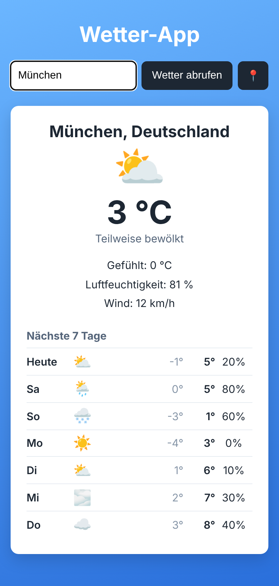

# Wetter-App

Eine kleine Wetter-App im Browser, entstanden als Übungsprojekt, um den Umgang mit Code, Git und GitHub zu lernen.

**👉 Online ausprobieren: https://frank-the-tank-73.github.io/wetter-app/**



## Funktionen

- Aktuelles Wetter für eine beliebige Stadt: Temperatur, gefühlte Temperatur, Luftfeuchtigkeit, Wind
- 7-Tage-Vorhersage mit Tiefst- und Höchstwerten sowie Regenwahrscheinlichkeit
- 📍 Wetter für den aktuellen Standort (der Browser fragt vorher um Erlaubnis)
- Die zuletzt gesuchte Stadt wird gemerkt und beim nächsten Öffnen direkt angezeigt
- Läuft auf Handy und Desktop

## Technik

- Reines HTML, CSS und JavaScript, ohne Frameworks und ohne Build-Schritt
- Wetterdaten von [Open-Meteo](https://open-meteo.com), kostenlos und ohne API-Key
- Veröffentlicht über GitHub Pages: Jeder Merge nach `main` geht automatisch online

## Projektstruktur

```
index.html          Seitenaufbau (Formular, Ergebnisbereich)
style.css           Design
js/app.js           Einstiegspunkt: verbindet Formular, Standort, Speicher, API und Anzeige
js/api.js           Abfragen an Open-Meteo (Geocoding und Wetter)
js/anzeige.js       Erzeugt das HTML für Wetter, Vorhersage, Ladeanzeige und Fehler
js/wettercodes.js   Übersetzt Wettercodes in Text und Symbol
docs/               Bilder für diese README
```

## Lokal starten

1. Repository klonen:
   ```bash
   git clone https://github.com/frank-the-tank-73/wetter-app.git
   ```
2. Den Ordner in VS Code öffnen.
3. Rechtsklick auf `index.html` → **„Open with Live Server“**.

Hinweis: Weil die App JavaScript-Module nutzt, funktioniert sie nicht per Doppelklick auf `index.html` (`file://`). Sie braucht einen kleinen Webserver wie Live Server.

## Lizenz

[MIT](LICENSE)
